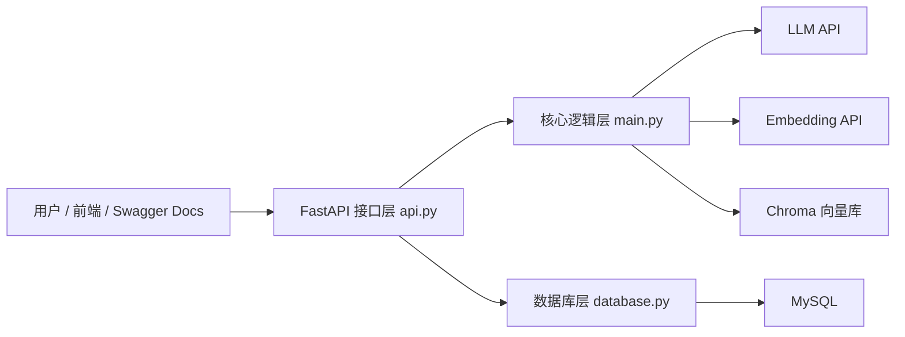
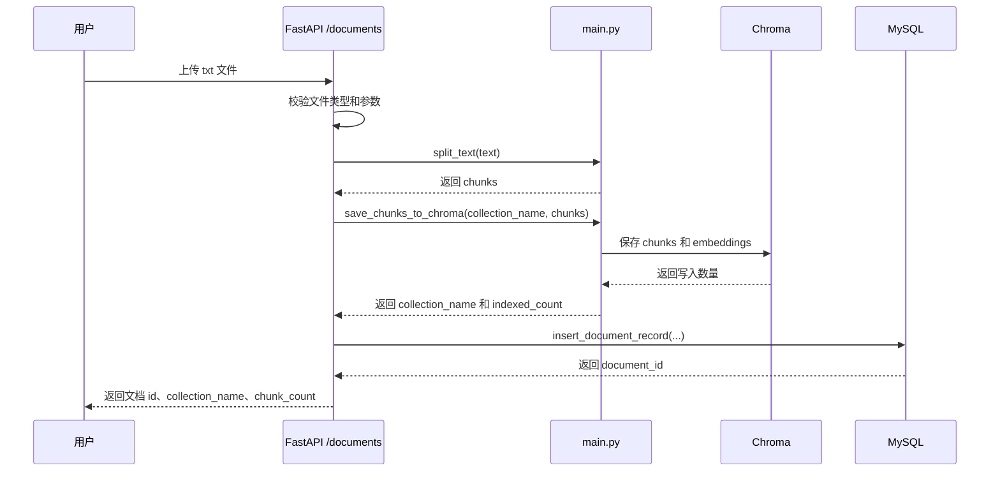
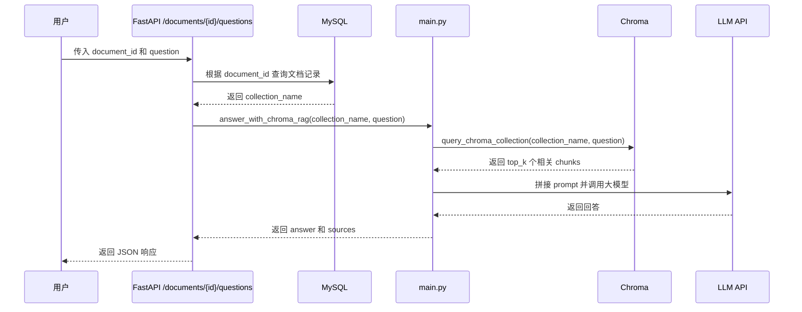

# 项目架构说明

这份文档用来说明 `ai-chat-starter` 的核心架构和数据流。

## 1. 总体架构



这几个模块的分工：

```text
api.py：接收 HTTP 请求，校验参数，返回 JSON。
main.py：处理 AI 相关逻辑，包括 LLM、embedding、文本切分、RAG、Chroma。
database.py：处理 MySQL 连接和文档记录 CRUD。
Chroma：保存 chunk embedding，并做向量相似度检索。
MySQL：保存结构化业务记录，例如文档 id、文件名、collection 名称、chunk 数量。
```

## 2. 上传文档流程



关键点：

```text
上传文档时，还没有用户问题。
这一步的重点是提前把文档切分并向量化，方便后面快速检索。
正式项目里通常会尽量把所有有效 chunks 存入向量库。
学习阶段可以通过 max_chunks 限制数量，避免 embedding API 消耗过多。
```

## 3. 根据文档提问流程



关键点：

```text
用户不需要自己传 collection_name。
更合理的接口是传 document_id。
后端通过 MySQL 找到 document_id 对应的 collection_name。
collection_name 是后端内部用来定位 Chroma collection 的技术细节。
```

## 4. Chroma 和 MySQL 的分工

### Chroma 负责什么

```text
保存 chunks
保存 chunk embeddings
根据问题 embedding 做相似度检索
返回最相关的 top_k 个 chunks
```

### MySQL 负责什么

```text
保存文档 id
保存文件名
保存 collection_name
保存 chunk_count
保存 indexed_count
保存 created_at
```

为什么不只用一个数据库？

```text
MySQL 擅长结构化数据和 CRUD。
Chroma 擅长向量检索。
文档问答系统通常需要两者配合。
```

## 5. API 层和核心逻辑层为什么要分开

如果所有代码都写在 `api.py` 里，文件会很快变得混乱：

```text
接口参数校验
文件读取
文本切分
embedding
Chroma 查询
LLM 调用
MySQL 写入
错误处理
```

所以项目现在把它们拆开：

```text
api.py 负责“外部怎么调用我”
main.py 负责“AI 逻辑怎么实现”
database.py 负责“数据怎么存取”
```

这就是后端项目里常见的分层思想。

## 6. 面试可以怎么讲

如果面试官问项目架构，可以这样回答：

```text
这个项目是一个基于 FastAPI 的文档问答后端服务。接口层负责接收文档上传和问答请求；核心逻辑层负责文本切分、embedding、向量检索和 LLM 调用；Chroma 用来保存向量并做相似度检索；MySQL 用来保存文档元数据。用户提问时，系统先通过 document_id 查询 MySQL 得到对应 collection，再从 Chroma 检索相关 chunks，最后把 chunks 和问题拼成 prompt 交给大模型生成回答。
```
